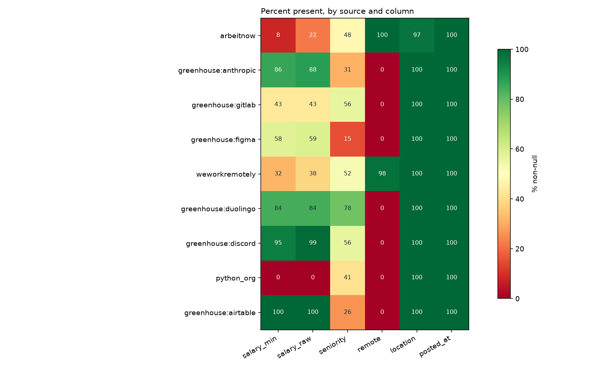
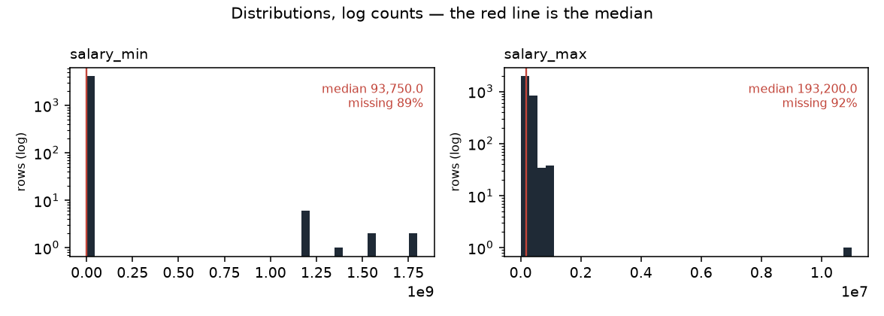

# Data profile — snapshot `2026-10-14`

| | |
|---|---|
| Generated by | `python -m src.data.profile` |
| Data | **real** · snapshot `2026-10-14` · `data/raw/2026-10-14/manifest.json` |
| Panel | 36,852 rows · sha256 `0c743fc100ea…` |
| Code | `b640656b8` on `main` (clean) |
| Snapshot sha256 | `e8a6fedac29b…` |
| Contents | 36,852 jobs · 200,972 observations · 473 runs |

_Regenerate rather than edit._

Measured facts only; the interpretation lives in `docs/data_dictionary.md`.

## Columns (`jobs`)

| column | dtype | non_null | null_pct | n_unique |
|---|---|---|---|---|
| id | int64 | 36,852 | 0.0 | 36,852 |
| source | string | 36,852 | 0.0 | 9 |
| source_id | string | 36,852 | 0.0 | 36,852 |
| title | string | 36,852 | 0.0 | 23,946 |
| company | string | 36,852 | 0.0 | 6,545 |
| location | string | 35,836 | 2.8 | 3,195 |
| remote | boolean | 35,068 | 4.8 | 2 |
| salary_min | Int64 | 4,144 | 88.8 | 539 |
| salary_max | Int64 | 2,886 | 92.2 | 471 |
| currency | string | 8,953 | 75.7 | 3 |
| salary_raw | string | 8,953 | 75.7 | 2,231 |
| posted_at | datetime64[us, UTC] | 36,852 | 0.0 | 286 |
| url | string | 36,852 | 0.0 | 36,852 |
| description | string | 36,811 | 0.1 | 30,835 |
| first_seen | datetime64[us, UTC] | 36,852 | 0.0 | 231 |
| last_seen | datetime64[us, UTC] | 36,852 | 0.0 | 230 |
| content_hash | string | 36,852 | 0.0 | 36,802 |
| hash_version | Int64 | 36,852 | 0.0 | 2 |
| seniority | string | 17,573 | 52.3 | 8 |
| parser_version | Int64 | 34,763 | 5.7 | 1 |
| remote_inferred | float64 | 2,810 | 92.4 | 1 |
| job_type_raw | str | 25,792 | 30.0 | 431 |
| tags_raw | str | 31,794 | 13.7 | 4,256 |
| seniority_stated | str | 12,870 | 65.1 | 6 |
| adapter_version | float64 | 31,107 | 15.6 | 1 |
| company_id | float64 | 33,924 | 7.9 | 6,218 |
| location_id | float64 | 32,996 | 10.5 | 2,989 |

## Coverage by source (% non-null)

Missing is not random here: the blocks of red are whole sources that never
populate a field, so "this column is null" is largely a restatement of which
board the row came from.

_Figures regenerate with the report; `.` is written beside it._

Read this as the missingness fingerprint: where a column is 0 or 100 for a
whole source, 'missing' is a synonym for 'came from that source'.

| source | jobs | salary_min | salary_raw | seniority | remote | location | posted_at |
|---|---|---|---|---|---|---|---|
| arbeitnow | 34,940 | 8 | 22 | 48 | 100 | 97 | 100 |
| greenhouse:anthropic | 915 | 86 | 88 | 31 | 0 | 100 | 100 |
| greenhouse:gitlab | 394 | 43 | 43 | 56 | 0 | 100 | 100 |
| greenhouse:figma | 223 | 58 | 59 | 15 | 0 | 100 | 100 |
| weworkremotely | 130 | 32 | 38 | 52 | 98 | 100 | 100 |
| greenhouse:duolingo | 108 | 84 | 84 | 78 | 0 | 100 | 100 |
| greenhouse:discord | 82 | 95 | 99 | 56 | 0 | 100 | 100 |
| python_org | 41 | 0 | 0 | 41 | 0 | 100 | 100 |
| greenhouse:airtable | 19 | 100 | 100 | 26 | 0 | 100 | 100 |

## Run completeness

`capped_runs` counts runs where `pages_fetched >= page_cap` — the scraper
stopped early, so the board was only partly observed and a posting's absence
from that run is not evidence it was removed.

| source | runs | ok | partial | failed | capped_runs | first_run | last_run |
|---|---|---|---|---|---|---|---|
| python_org | 71 | 59 | 11 | 1 | 0 | 2026-08-29 | 2026-10-14 |
| arbeitnow | 66 | 9 | 56 | 1 | 37 | 2026-08-29 | 2026-10-14 |
| greenhouse:airtable | 49 | 48 | 0 | 1 | 0 | 2026-08-30 | 2026-10-14 |
| greenhouse:anthropic | 49 | 48 | 0 | 1 | 0 | 2026-08-30 | 2026-10-14 |
| greenhouse:discord | 49 | 48 | 0 | 1 | 0 | 2026-08-30 | 2026-10-14 |
| greenhouse:duolingo | 49 | 48 | 0 | 1 | 0 | 2026-08-30 | 2026-10-14 |
| greenhouse:figma | 49 | 48 | 0 | 1 | 0 | 2026-08-30 | 2026-10-14 |
| greenhouse:gitlab | 49 | 48 | 0 | 1 | 0 | 2026-08-30 | 2026-10-14 |
| weworkremotely | 42 | 0 | 41 | 1 | 2 | 2026-09-07 | 2026-10-14 |

## Panel shape

| source | jobs | mean_days_seen | max_days_seen | seen_once | seen_once_pct |
|---|---|---|---|---|---|
| arbeitnow | 34,940 | 3.7 | 19 | 9,721 | 27.8 |
| greenhouse:anthropic | 915 | 29.6 | 44 | 11 | 1.2 |
| greenhouse:gitlab | 394 | 24.2 | 44 | 9 | 2.3 |
| greenhouse:figma | 223 | 31.1 | 44 | 2 | 0.9 |
| weworkremotely | 130 | 6.9 | 22 | 33 | 25.4 |
| greenhouse:duolingo | 108 | 31.6 | 44 | 0 | 0.0 |
| greenhouse:discord | 82 | 25.9 | 44 | 3 | 3.7 |
| python_org | 41 | 31.3 | 45 | 1 | 2.4 |
| greenhouse:airtable | 19 | 23.3 | 44 | 0 | 0.0 |
